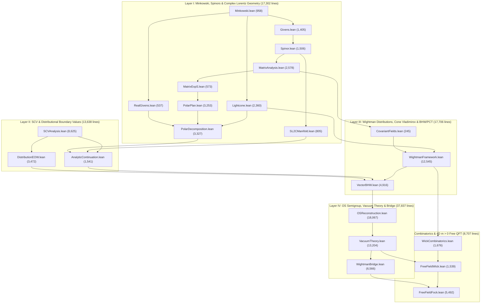

# Axiomatic & Constructive Quantum Field Theory in Lean 4

A machine-checked Lean 4 formalization of **4-dimensional relativistic axiomatic and constructive Quantum Field Theory (QFT)** built on [Mathlib](https://github.com/leanprover-community/mathlib4) (`v4.32.2`).

Starting from real and complex Minkowski geometry, the spinor double cover $SL(2,\mathbb{C}) \times SL(2,\mathbb{C}) \to SO^+(1,3;\mathbb{C})$, several complex variables, and Schwartz tempered distributions, this library develops:

1. **Complex Lorentz Geometry & Jost's Theorem**: Real and complex Lorentz groups, polar/Cartan/Jordan decompositions, path-connectedness of forward-tube stabilizer orbits, and the equivalence between real Jost configurations and real points of the extended tube ($n > 1$).
2. **UV-Cutoff-Free Cone Vladimirov Boundary Values & Locality**: Construction of forward-tube holomorphic extensions (`coneVladimirovTubeExtension`) for arbitrary Poincaré-covariant tempered Wightman families satisfying the relativistic forward-cone `SpectrumCondition`—with no ultraviolet momentum cutoff—together with the derivation of Jost `WeakLocality` from adjacent spacelike `LocalCommutativity`.
3. **General Spinor Bargmann–Hall–Wightman (BHW) & Relativistic PCT Theorems**: Single-valued analytic continuation from the forward tube $\mathcal{T}_n$ to the extended tube $\mathcal{T}'_n$ for arbitrary finite-dimensional polynomial representations of $SL(2,\mathbb{C}) \times SL(2,\mathbb{C})$, equivalence of forward-tube PCT symmetry and Jost weak locality (`tubePCT_iff_weakLocality`), and the full distributional relativistic PCT theorem (`wightman_pct_of_spectrumCondition`).
4. **Osterwalder–Schrader (OS) Semigroup, Spin–Statistics & Unconditional Uniqueness**: Construction of the OS GNS Hilbert space from reflection positivity on time-ordered Euclidean configurations, self-adjointness and weak holomorphy of the OS contraction semigroup, unconditional uniqueness of the reconstructed Wightman theory (`wightman_unique_unconditional`), spectral-measure reconstruction bridges, and unconditional Spin–Statistics theorems for scalar, 4-vector, and concrete massive free fields.
5. **Constructive 4D Massive ($m > 0$) Free Klein–Gordon & Spin-$1/2$ Dirac QFT**: All-$n$-point bosonic and fermionic Wick combinatorics (including partial-pairing crossing parity), explicit mass-shell tempered Wightman distributions and Euclidean Schwinger functions, symmetric and antisymmetric $L^2$ Fock space representations proving all-$n$-point Wightman positivity and OS reflection positivity, sharp mass-gap exponential time clustering $\mathcal{O}(e^{-m\tau})$, and Lorentz cluster decomposition along every nonzero spacetime direction $a \neq 0$ (`WightmanAxiomsWithUniqueVacuum`).

---

## Table of Contents

1. [Verification Guarantees & Codebase Metrics](#1-verification-guarantees--codebase-metrics)
2. [Architecture & Module Dependency Graph](#2-architecture--module-dependency-graph)
3. [Core Mathematical Definitions (Verbatim Lean 4)](#3-core-mathematical-definitions-verbatim-lean-4)
4. [Main Formalized Theorems (Verbatim Lean 4)](#4-main-formalized-theorems-verbatim-lean-4)
5. [Non-Vacuity Witnesses & No-Go Theorems](#5-non-vacuity-witnesses--no-go-theorems)
6. [Key Proof Architectures & Technical Highlights](#6-key-proof-architectures--technical-highlights)
7. [Mathematical Scope, Design Choices & Open Boundaries](#7-mathematical-scope-design-choices--open-boundaries)
8. [Build Instructions, Axiom Verification & Literature Cross-Reference](#8-build-instructions-axiom-verification--literature-cross-reference)

---

## 1. Verification Guarantees & Codebase Metrics

Formalizing infinite-dimensional functional analysis and axiomatic QFT carries well-known specification hazards: definitions can inadvertently collapse to zero-momentum constants via ultraviolet cutoffs, structures can become uninhabited due to incompatible sign or chirality conventions, or theorems can hold vacuously. Every module in this formalization is audited against both the Lean 4 kernel and explicit non-degeneracy witnesses.

| Metric | Verified Value | Details |
| :--- | :---: | :--- |
| **Lean 4 / Mathlib Toolchain** | `v4.32.2` | `leanprover/lean4:v4.32.2` with `mathlib` `v4.32.2` |
| **QFT & Analysis Modules** | **22 files** | Located in `src/` (see [Section 2](#2-architecture--module-dependency-graph)) |
| **Total Lines of Lean 4** | **95,190 lines** | Comment-free, linter-clean (`weak.linter.mathlibStandardSet = true`) |
| **Top-Level Declarations** | **6,363** | `1,856` `theorem`, `3,288` `lemma`, `1,102` `def`, `33` `abbrev`, `30` `structure`, `54` `instance` |
| **`sorry` / `admit` / Custom `axiom`** | **0** | Complete end-to-end kernel proofs |
| **`unsafe` / `opaque` / Metaprogramming Bypasses** | **0** | Purely logical definitions and proofs |
| **Permitted Kernel Axioms** | **Standard 3 only** | Every theorem depends exclusively on `[propext, Classical.choice, Quot.sound]` |
| **Vacuous Positive Theorems** | **0** | Kernel-audited: zero positive theorems proved via empty-type elimination (`False.elim` / `IsEmpty`) |
| **Concrete 4D $m > 0$ Models** | **2 full theories** | Massive real scalar Klein–Gordon ($\eta = +1$) and spin-$1/2$ Dirac ($\eta = -1$) fields |

---

## 2. Architecture & Module Dependency Graph

The 22 modules are organized into five mathematical layers. Arrows in the dependency graph point from imported foundational modules to downstream consumers (`A --> B` means `B` imports `A`).



### Complete Module Inventory

#### Layer I: Minkowski Geometry, $SL(2,\mathbb{C})$ Spinors & Complex Lorentz Polar Decomposition (`17,302` lines)

| Module | Lines | Mathematical Scope |
| :--- | ---: | :--- |
| `src/Minkowski.lean` | 958 | Signature $(+,-,-,-)$ real and complex Minkowski metrics, forward/backward lightcones, real and complex Lorentz groups, forward tube $\mathcal{T}_n$, extended tube $\mathcal{T}'_n$, and Jost convex hulls/points. |
| `src/Givens.lean` | 1,405 | Complex Givens rotations and elementary $SL(2,\mathbb{C})$ / $SO(4,\mathbb{C})$ matrix factorizations. |
| `src/RealGivens.lean` | 537 | Real orthogonal Givens reductions and $SO(3)$ / $SO^+(1,3)$ boost-rotation decompositions. |
| `src/Spinor.lean` | 1,506 | Pauli/Hermitian $2 \times 2$ encoding of 4-vectors, the double-cover homomorphism `spinorPhi : SL(2,ℂ) × SL(2,ℂ) →* SO⁺(1,3;ℂ)`, and surjectivity onto proper orthochronous Lorentz transformations. |
| `src/SL2CManifold.lean` | 805 | Complex Lie-manifold topology, path-connectedness, and holomorphic chart structure of $SL(2,\mathbb{C})$. |
| `src/MatrixAnalysis.lean` | 2,578 | Matrix norms, spectral/Jordan analysis, convergent power series, and complex orthogonal Lie algebra estimates. |
| `src/MatrixExpS.lean` | 573 | Exponential map properties for complex skew-Minkowski generators and determinant/metric preservation. |
| `src/PolarPlan.lean` | 3,253 | Complex Lorentz polar and Cartan decompositions $\Lambda = R \exp(i B)$ and canonical normal forms of Minkowski-skew generators. |
| `src/Lightcone.lean` | 2,360 | Hahn–Banach hyperplane separation of Jost convex hulls from the forward lightcone, complex boost mapping into $\mathcal{T}_n$, and **Jost's Theorem** (`jost_theorem`). |
| `src/PolarDecomposition.lean` | 3,327 | Path-connectedness of complex Lorentz orbit domains `{Λ ∈ SO⁺(1,3;ℂ) | Λ • z ∈ forward_tube_n n}` (`orbit_domain_path_connected`), eliminating multi-valuedness in BHW continuation. |

#### Layer II: Several Complex Variables (SCV) & Distributional Boundary Values (`13,638` lines)

| Module | Lines | Mathematical Scope |
| :--- | ---: | :--- |
| `src/SCVAnalysis.lean` | 8,625 | Polydisc Cauchy integral formulas, Hartogs separate-to-joint analyticity infrastructure, identity theorems on connected open sets in $\mathbb{C}^N$, 2D bounded L-shaped **Bochner Tube Theorem** (`bochner_tube_theorem`), and 1D Morera/Edge-of-the-Wedge extension (`orthant_eow_extension_1d`). |
| `src/DistributionEOW.lean` | 3,472 | Test-function spaces $\mathcal{D}(\Omega)$ and distributions $\mathcal{D}'(\Omega,\mathbb{C})$, distributional boundary values from open cones, and 1D local distributional Edge-of-the-Wedge theorem (`local_eow_1d_of_continuous_boundary`). |
| `src/AnalyticContinuation.lean` | 1,541 | Scalar Bargmann–Hall–Wightman continuation from $\mathcal{T}_n$ to $\mathcal{T}'_n$ by gluing along path-connected complex Lorentz orbits. |

#### Layer III: Tempered Wightman Distributions, Cone Vladimirov Extension & Spinor BHW/PCT (`17,706` lines)

| Module | Lines | Mathematical Scope |
| :--- | ---: | :--- |
| `src/CovariantFields.lean` | 245 | Finite-dimensional polynomial representations `HolomorphicLorentzRep ι` of $SL(2,\mathbb{C}) \times SL(2,\mathbb{C})$, restricted real representations `R.rep`, and distributional `PoincareCovariant`. |
| `src/WightmanFramework.lean` | 12,545 | `WightmanFamily`, Minkowski Fourier transforms, relativistic `SpectrumCondition`, adjacent spacelike `LocalCommutativity` $\implies$ `PermSpacelikeLocality` $\implies$ Jost `WeakLocality`, `Positivity`, and the **UV-cutoff-free Cone Vladimirov Tube Extension** (`coneVladimirovTubeExtension`) via Schwartz finite-order jet factorizations and Hahn–Banach extension. |
| `src/VectorBHW.lean` | 4,916 | **General Spinor BHW Theorem** (`spinor_bhw_theorem`), real-to-complex Lorentz covariance promotion, **Relativistic PCT Theorem** (`wightman_pct_of_spectrumCondition`), chiral Weyl star-structure no-go (`isEmpty_starStructure_leftWeylRep`), and abstract Spin–Statistics infrastructure. |

#### Layer IV: Osterwalder–Schrader Semigroup, Vacuum Theory & Euclidean–Lorentzian Bridge (`37,837` lines)

| Module | Lines | Mathematical Scope |
| :--- | ---: | :--- |
| `src/OSReconstruction.lean` | 18,067 | Time-ordered Euclidean domain `orderedEuclidN n`, `OSAxioms` (smoothness, Euclidean translation & $SU(2) \times SU(2)$ rotation covariance, Hermitian reflection positivity, PT symmetry), GNS quotient/completion OS Hilbert space, self-adjoint contraction semigroup `OSHolomorphicSemigroup`, **unconditional Wightman uniqueness** (`wightman_unique_unconditional`), scalar/4-vector Spin–Statistics from any nonzero $n$-point function, and spectral-measure OS reconstruction (`osterwalder_schrader_measure_reconstruction_of_data`). |
| `src/VacuumTheory.lean` | 13,204 | Equivalence `tubePCT_iff_weakLocality`, Spin–Statistics from `TubePCT` + `WeakLocality`, explicit 4-momentum symmetry-breaking counterexamples (`fourMomentumW q`, `fourMomentumS q` for $q \neq 0$), and standalone 2-point / $n$-point massive propagator analysis. |
| `src/WightmanBridge.lean` | 6,566 | Bundled relativistic `WightmanAxioms` and `WightmanAxiomsWithUniqueVacuum`, Wightman GNS Hilbert space construction, cyclic vacuum vector, unitary translation operators, Lorentz cluster decomposition $\implies$ 1D vacuum uniqueness, and bridges from OS data to `WightmanAxioms`. |

#### Layer V: Wick Combinatorics & 4D $m > 0$ Constructive Free QFT on $L^2$ Fock Space (`8,707` lines)

| Module | Lines | Mathematical Scope |
| :--- | ---: | :--- |
| `src/WickCombinatorics.lean` | 1,676 | Fixed-point-free involutions (`ChordPairing`), partial pairings (`PartialPairing`), reversed concatenation bijections (`concatRev`), and exact fermionic chord-crossing parity decomposition (`cross_concatRev`). |
| `src/FreeFieldWick.lean` | 1,539 | Lorentz-invariant positive-energy mass-shell measures ($m > 0$), all-$n$-point Wick expansions `freeKGW`, `freeKGS`, `freeDiracW`, `freeDiracS`, forward-cone spectrum condition, Poincaré covariance, Jost weak (anti)locality, PCT, non-degeneracy, `¬ ZeroMomentumSpectrumCondition`, and unconditional Spin–Statistics ($\eta = +1$ for KG, $\eta = -1$ for Dirac). |
| `src/FreeFieldFock.lean` | 5,492 | Direct-sum $\sigma$-finite measure-theoretic Fock space `FockHilbert ν = Lp ℂ 2 (fockMeasure ν)`, symmetric/antisymmetric sector projections, all-$n$-point Wightman `Positivity` and `OSReflectionPositive`, `freeKGOSAxioms` & `freeDiracOSAxioms`, sharp exponential OS clustering $e^{-m\tau}$, continuous spectral measure instantiation of OS reconstruction, non-stationary phase along every $a \neq 0$ for 4D Lorentz clustering, `freeKGWightmanAxiomsWithUniqueVacuum` & `freeDiracWightmanAxiomsWithUniqueVacuum`, and `freeKG_grand_master` / `freeDirac_grand_master`. |

---

## 3. Core Mathematical Definitions (Verbatim Lean 4)

To make the exact mathematical content completely transparent—without paraphrasing—all primary definitions below are reproduced verbatim from `src/`.

### 3.1 Minkowski Geometry, Complex Tubes & Jost Points (`Minkowski.lean`)

Spacetime points are modeled as `Fin 4 → ℝ` (and complexified spacetime as `Fin 4 → ℂ`) with the signature $(+,-,-,-)$ inner product $x \cdot y = x^0 y^0 - x^1 y^1 - x^2 y^2 - x^3 y^3$. The forward tube $\mathcal{T}_n$ requires every successive difference $z_i - z_{i+1}$ to have its negated imaginary part in the open forward lightcone $V^+$:

```lean
def minkowskiInner (x y : Fin 4 → ℝ) : ℝ :=
  dotProduct x (minkowskiMetricReal.mulVec y)

def forward_light_cone : Set (Fin 4 → ℝ) :=
  { x | x 0 > 0 ∧ minkowskiInner x x > 0 }

def forward_tube_n (n : ℕ) : Set (Fin n → Fin 4 → ℂ) :=
  { z | ∀ (i : Fin n) (hi : i.val + 1 < n),
    (fun k => -((z i - z ⟨i.val + 1, hi⟩) k).im) ∈ forward_light_cone }

def extended_tube_n (n : ℕ) : Set (Fin n → Fin 4 → ℂ) :=
  ⋃ Λ : SpecialSpecialComplexLorentzGroup, (fun z => Λ • z) '' forward_tube_n n

def is_spacelike (v : Fin 4 → ℝ) : Prop :=
  minkowskiInner v v < 0

def jost_differences_n (n : ℕ) (x : Fin n → Fin 4 → ℝ) : Set (Fin 4 → ℝ) :=
  { v | ∃ (i : Fin n) (hi : i.val + 1 < n), v = x i - x ⟨i.val + 1, hi⟩ }

def jost_convex_hull (n : ℕ) (x : Fin n → Fin 4 → ℝ) : Set (Fin 4 → ℝ) :=
  convexHull ℝ (jost_differences_n n x)

def jost_points_n (n : ℕ) : Set (Fin n → Fin 4 → ℝ) :=
  { x | ∀ v ∈ jost_convex_hull n x, is_spacelike v }
```

### 3.2 Holomorphic Spinor Representations & Star Structures (`CovariantFields.lean`, `WightmanFramework.lean`)

Arbitrary spinor/tensor field multiplets indexed by a finite type `ι` carry a multiplicative representation $\sigma : SL(2,\mathbb{C}) \times SL(2,\mathbb{C}) \to \mathrm{Mat}_{\iota \times \iota}(\mathbb{C})$ whose matrix entries are complex polynomials in the entries of $(A, B) \in SL(2,\mathbb{C}) \times SL(2,\mathbb{C})$. Restricting along the diagonal embedding $A \mapsto (A, \overline{A})$ yields the physical real $SL(2,\mathbb{C})$ representation `R.rep`:

```lean
structure HolomorphicLorentzRep (ι : Type*) [Fintype ι] [DecidableEq ι] where
  σ : SL2C × SL2C →* Matrix ι ι ℂ
  polynomial : ∀ i j : ι, ∃ P : MvPolynomial ((Fin 2 × Fin 2) ⊕ (Fin 2 × Fin 2)) ℂ,
    ∀ p : SL2C × SL2C,
      σ p i j = MvPolynomial.eval
        (Sum.elim (fun a => (p.1 : Matrix (Fin 2) (Fin 2) ℂ) a.1 a.2)
                  (fun a => (p.2 : Matrix (Fin 2) (Fin 2) ℂ) a.1 a.2)) P

noncomputable def HolomorphicLorentzRep.rep (R : HolomorphicLorentzRep ι) :
    SL2C →* Matrix ι ι ℂ :=
  R.σ.comp ((MonoidHom.id SL2C).prod sl2cConjHom)

def PoincareCovariant {ι : Type*} [Fintype ι] [DecidableEq ι] (R : HolomorphicLorentzRep ι)
    (W : ∀ n : ℕ, (Fin n → ι) → TemperedDistribution (Fin n → Fin 4 → ℝ) ℂ) : Prop :=
  ∀ (n : ℕ) (a : Fin 4 → ℝ) (A : SL2C)
    (f f' : SchwartzMap (Fin n → Fin 4 → ℝ) ℂ),
    (∀ x : Fin n → Fin 4 → ℝ, f' (fun i => poincareAct a A (x i)) = f x) →
    ∀ α : Fin n → ι,
      W n α f' = ∑ β : Fin n → ι, (∏ i, R.rep A (α i) (β i)) * W n β f

structure StarStructure (R : HolomorphicLorentzRep ι) where
  C : Matrix ι ι ℂ
  involutive : C * C.map star = 1
  intertwine : ∀ A B : SL2C,
    C * R.σ (A, B) = (R.σ (sl2c_conj B, sl2c_conj A)).map star * C
```

Concrete instances include `trivialRep` / `trivialStarStructure` (scalar fields, $\iota = \mathrm{Unit}$), `stdRep` / `stdStarStructure` (4-vector fields, $\iota = \mathrm{Fin}\ 4$), `leftWeylRep` and `rightWeylRep` (2-component chiral Weyl spinors, $\iota = \mathrm{Fin}\ 2$), and `diracRep` / `diracStarStructure` (4-component $(1/2,0) \oplus (0,1/2)$ Dirac bispinors, $\iota = \mathrm{Fin}\ 2 \oplus \mathrm{Fin}\ 2$, with off-diagonal chiral swap matrix $C = \gamma^0$).

### 3.3 Tempered Wightman Distributions, Spectrum, Locality, Positivity & Tube Extensions (`WightmanFramework.lean`, `VectorBHW.lean`)

An $n$-point Wightman function is a genuine Mathlib `TemperedDistribution` (a continuous linear functional `SchwartzMap (Fin n → Fin 4 → ℝ) ℂ →L[ℂ] ℂ`). The relativistic `SpectrumCondition` asserts that $W_n(f) = 0$ whenever the Minkowski Fourier transform of $f$ vanishes on an open neighborhood of the joint forward-cone spectral region $\sum_{i=0}^{n-1} p_i = 0$, $\sum_{i \le k} p_i \in \overline{V^+}$:

```lean
abbrev WightmanFamily (ι : Type*) : Type _ :=
  ∀ n : ℕ, (Fin n → ι) → TemperedDistribution (Fin n → Fin 4 → ℝ) ℂ

noncomputable def minkowskiFourier {n : ℕ} (f : SchwartzMap (Fin n → Fin 4 → ℝ) ℂ)
    (p : Fin n → Fin 4 → ℝ) : ℂ :=
  ∫ x : Fin n → Fin 4 → ℝ,
    f x * Complex.exp (-(Complex.I * ((∑ k, minkowskiInner (p k) (x k) : ℝ) : ℂ)))

def spectralRegion (n : ℕ) : Set (Fin n → Fin 4 → ℝ) :=
  { p | (∑ i, p i = 0) ∧
    (∀ k : Fin n, (∑ i ∈ Finset.univ.filter (fun i : Fin n => i ≤ k), p i) ∈
      closure forward_light_cone) }

def SpectrumCondition (W : WightmanFamily ι) : Prop :=
  ∀ (n : ℕ) (α : Fin n → ι) (f : SchwartzMap (Fin n → Fin 4 → ℝ) ℂ),
    (∃ U : Set (Fin n → Fin 4 → ℝ), IsOpen U ∧ spectralRegion n ⊆ U ∧
      ∀ p ∈ U, minkowskiFourier f p = 0) → W n α f = 0

def LocalCommutativity (η : ℂ) (W : WightmanFamily ι) : Prop :=
  ∀ (n : ℕ) (i : Fin n) (hi : i.val + 1 < n) (α : Fin n → ι)
    (f f' : SchwartzMap (Fin n → Fin 4 → ℝ) ℂ),
    tsupport (f : (Fin n → Fin 4 → ℝ) → ℂ) ⊆
      { x | is_spacelike (x i - x ⟨i.val + 1, hi⟩) } →
    (∀ x : Fin n → Fin 4 → ℝ, f' (x ∘ Equiv.swap i ⟨i.val + 1, hi⟩) = f x) →
    W n α f = η * W n (α ∘ Equiv.swap i ⟨i.val + 1, hi⟩) f'

def WeakLocality (η : ℂ) (W : WightmanFamily ι) : Prop :=
  ∀ (n : ℕ) (α : Fin n → ι) (f f' : SchwartzMap (Fin n → Fin 4 → ℝ) ℂ),
    tsupport (f : (Fin n → Fin 4 → ℝ) → ℂ) ⊆ jost_points_n n →
    (∀ x : Fin n → Fin 4 → ℝ, f' (fun i => x (Fin.rev i)) = f x) →
    W n α f = η ^ (n * (n - 1) / 2) * W n (α ∘ Fin.rev) f'

def Positivity {R : HolomorphicLorentzRep ι} (S : StarStructure R) (W : WightmanFamily ι) :
    Prop :=
  ∀ (N : ℕ) (F : ∀ j : ℕ, (Fin j → ι) → SchwartzMap (Fin j → Fin 4 → ℝ) ℂ)
    (G : ∀ j k : ℕ, (Fin j → ι) → (Fin k → ι) →
      SchwartzMap (Fin (j + k) → Fin 4 → ℝ) ℂ),
    (∀ j k α α' (x : Fin (j + k) → Fin 4 → ℝ),
      G j k α α' x =
        (starRingEnd ℂ) (F j α (fun i => x (Fin.castAdd k (Fin.rev i)))) *
          F k α' (fun i => x (Fin.natAdd j i))) →
    0 ≤ ∑ j ∈ Finset.range (N + 1), ∑ k ∈ Finset.range (N + 1),
      ∑ α : Fin j → ι, ∑ α' : Fin k → ι, ∑ β : Fin j → ι,
        (∏ i, S.C (α i) (β i)) * W (j + k) (Fin.append (β ∘ Fin.rev) α') (G j k α α')
```

Holomorphic forward-tube extensions, tube Lorentz covariance, and tube/distributional PCT symmetry are defined by:

```lean
structure TubeExtension (W : WightmanFamily ι) where
  H : ∀ n : ℕ, (Fin n → ι) → (Fin n → Fin 4 → ℂ) → ℂ
  analytic : ∀ n α, AnalyticOn ℂ (H n α) (forward_tube_n n)
  boundary : ∀ (n : ℕ) (α : Fin n → ι) (f : SchwartzMap (Fin n → Fin 4 → ℝ) ℂ)
    (v : Fin 4 → ℝ), v ∈ forward_light_cone →
    Tendsto (fun t : ℝ => ∫ x : Fin n → Fin 4 → ℝ,
        H n α (fun i k => (x i k : ℂ) + Complex.I * ((t * (i : ℕ) * v k : ℝ) : ℂ)) * f x)
      (𝓝[>] 0) (𝓝 (W n α f))

def TubeCovariant {W : WightmanFamily ι} (R : HolomorphicLorentzRep ι)
    (E : TubeExtension W) : Prop :=
  ∀ (n : ℕ) (A : SL2C) (z : Fin n → Fin 4 → ℂ),
    z ∈ forward_tube_n n → spinorPhi (A, sl2c_conj A) • z ∈ forward_tube_n n →
    ∀ α : Fin n → ι,
      E.H n α (spinorPhi (A, sl2c_conj A) • z) =
        ∑ β : Fin n → ι, (∏ i, R.rep A (α i) (β i)) * E.H n β z

def TubePCT (η : ℂ) (R : HolomorphicLorentzRep ι) {W : WightmanFamily ι}
    (E : TubeExtension W) : Prop :=
  ∀ (n : ℕ) (α : Fin n → ι), ∀ z ∈ forward_tube_n n,
    E.H n α (-(z ∘ Fin.rev)) =
      η ^ (n * (n - 1) / 2) *
        ∑ β : Fin n → ι, (∏ i, R.σ (-1, 1) (α i) (β i)) * E.H n (β ∘ Fin.rev) z

def WightmanPCT (η : ℂ) (R : HolomorphicLorentzRep ι) (W : WightmanFamily ι) : Prop :=
  ∀ (n : ℕ) (α : Fin n → ι) (f f' : SchwartzMap (Fin n → Fin 4 → ℝ) ℂ),
    (∀ x : Fin n → Fin 4 → ℝ, f' (fun i => -x (Fin.rev i)) = f x) →
    W n α f =
      η ^ (n * (n - 1) / 2) *
        ∑ β : Fin n → ι, (∏ i, R.σ (-1, 1) (α i) (β i)) * W n (β ∘ Fin.rev) f'
```

### 3.4 Bundled Relativistic Wightman Axiom Systems (`WightmanBridge.lean`)

`WightmanAxioms` and `WightmanAxiomsWithUniqueVacuum` package the relativistic Wightman axioms together with their GNS Hilbert space `A.Hilbert`, cyclic vacuum vector `A.vacuum`, all-direction cluster decomposition ($\forall a \neq 0$), and uniqueness of translation-invariant vectors:

```lean
structure WightmanAxioms (R : HolomorphicLorentzRep ι) (S : StarStructure R)
    (η : ℂ) where
  WData : WightmanPositiveData R S
  E : TubeExtension WData.W
  positivity : Positivity S WData.W
  poincare : PoincareCovariant R WData.W
  spectrum : ForwardConeSpectrumCondition WData.W
  weakLocality : WeakLocality η WData.W
  tube_covariant : TubeCovariant R E
  tube_pct : TubePCT η R E
  cyclic : WightmanVacuumCyclic WData

structure WightmanAxiomsWithUniqueVacuum
    (R : HolomorphicLorentzRep ι) (S : StarStructure R) (η : ℂ) extends
    WightmanAxioms R S η where
  vacuumNormalized : WightmanVacuumNormalized S WData.W
  cluster : ∀ a : Fin 4 → ℝ, a ≠ 0 → WightmanClusterAlong WData a
  vacuumUnique :
    WightmanVacuumUnique WData
      (wightmanTranslationInvariant_of_poincare R poincare)
```

*(Note: `ForwardConeSpectrumCondition` is `abbrev ForwardConeSpectrumCondition (W : WightmanFamily ι) : Prop := SpectrumCondition W`.)*

### 3.5 Time-Ordered Euclidean Configurations & Osterwalder–Schrader Axioms (`OSReconstruction.lean`)

On the Euclidean side, Schwinger functions are defined on strictly time-ordered Euclidean configurations $x_0^0 < x_1^0 < \dots < x_{n-1}^0$, with $SU(2) \times SU(2)$ Euclidean spinor rotation covariance, Euclidean translation invariance, Hermitian reflection positivity on positive-time configurations (`OSConfig ι →₀ ℂ`), and Euclidean PT reversal symmetry:

```lean
def orderedEuclidN (n : ℕ) : Set (Fin n → Fin 4 → ℝ) :=
  { x | ∀ (i : Fin n) (hi : i.val + 1 < n), x i 0 < x ⟨i.val + 1, hi⟩ 0 }

def OSReflectionPositive {R : HolomorphicLorentzRep ι} (S : StarStructure R)
    (𝒮 : SchwingerFamily ι) : Prop :=
  ∀ Ψ : OSConfig ι →₀ ℂ, 0 ≤ (osPreInner S 𝒮 Ψ Ψ).re

def OSTranslationInvariant (𝒮 : SchwingerFamily ι) : Prop :=
  ∀ (n : ℕ) (α : Fin n → ι) (x : Fin n → Fin 4 → ℝ),
    x ∈ orderedEuclidN n → ∀ a : Fin 4 → ℝ,
    𝒮 n α (fun i => x i + a) = 𝒮 n α x

def EuclidRotCovariant (R : HolomorphicLorentzRep ι) (𝒮 : SchwingerFamily ι) : Prop :=
  ∀ (n : ℕ) (U V : SU2) (x : Fin n → Fin 4 → ℝ),
    x ∈ orderedEuclidN n → euclidRotN n U V x ∈ orderedEuclidN n →
    ∀ α : Fin n → ι,
    𝒮 n α (euclidRotN n U V x) =
      ∑ β : Fin n → ι,
        (∏ i : Fin n, R.σ (su2ToSL2C U, su2ToSL2C V) (α i) (β i)) * 𝒮 n β x

structure OSAxioms (R : HolomorphicLorentzRep ι) (S : StarStructure R)
    (η : ℂ) (𝒮 : SchwingerFamily ι) : Prop where
  os0_smooth : ∀ (n : ℕ) (α : Fin n → ι),
    ContDiffOn ℝ (⊤ : ℕ∞) (𝒮 n α) (orderedEuclidN n)
  os1_translation : OSTranslationInvariant 𝒮
  os1_rotation : EuclidRotCovariant R 𝒮
  os2_hermiticity : OSHermiticity S 𝒮
  os2_positivity : OSReflectionPositive S 𝒮
  os3_symmetry : ∀ (n : ℕ) (α : Fin n → ι) (x : Fin n → Fin 4 → ℝ),
    x ∈ orderedEuclidN n →
    𝒮 n α (-(x ∘ Fin.rev)) =
      η ^ (n * (n - 1) / 2) *
        ∑ β : Fin n → ι,
          (∏ i : Fin n, R.σ (-1, 1) (α i) (β i)) * 𝒮 n (β ∘ Fin.rev) x

def OSTimeClusterDecomposition {R : HolomorphicLorentzRep ι} {S : StarStructure R}
    (D : OSReflectionPositiveData R S) : Prop :=
  ∀ A B : OSConfig ι,
    Tendsto
      (fun τ : ℝ =>
        osKernel S D.𝒮 A (osConfigTimeShift (max τ 0) (le_max_right τ 0) B))
      atTop
      (𝓝 (osKernel S D.𝒮 A (osVacuumConfig ι) *
        osKernel S D.𝒮 (osVacuumConfig ι) B))
```

### 3.6 Wick Pairings, $L^2$ Fock Space & 4D $m > 0$ Free Fields (`WickCombinatorics.lean`, `FreeFieldWick.lean`, `FreeFieldFock.lean`)

All-$n$-point free fields are built via complete chord pairings (`ChordPairing n`), partial pairings (`PartialPairing n r`, which factorize an $(j+k)$-point Wick sum across the $t = 0$ hyperplane into $r$-particle intermediate states), and a genuine Mathlib $L^2$ space `FockHilbert ν` over the $\sigma$-finite direct sum of $r$-particle momentum-spin sectors:

```lean
structure ChordPairing (n : ℕ) where
  mate : Equiv.Perm (Fin n)
  involutive : Function.Involutive mate
  ne_self : ∀ i : Fin n, mate i ≠ i

structure PartialPairing (n r : ℕ) where
  unpaired : Fin r → Fin n
  strictMono_unpaired : StrictMono unpaired
  mate : Equiv.Perm (Fin n)
  involutive : Function.Involutive mate
  fixed_iff : ∀ i : Fin n, mate i = i ↔ ∃ a : Fin r, unpaired a = i

abbrev FockHilbert (ν : ℕ) : Type :=
  MeasureTheory.Lp ℂ 2 (fockMeasure ν)

noncomputable def freeKGW (m : ℝ) (hm : 0 < m) : WightmanFamily Unit :=
  wickMassShellW m 1 massiveKGCoeff (massiveKGCoeff_data hm)

noncomputable def freeKGS (m : ℝ) (hm : 0 < m) : SchwingerFamily Unit :=
  wickMassShellS m hm 1 massiveKGCoeff (massiveKGCoeff_data hm)

noncomputable def freeDiracW (m : ℝ) (hm : 0 < m) :
    WightmanFamily (Fin 2 ⊕ Fin 2) :=
  wickMassShellW m (-1) (diracMassShellCoeff m) (diracMassShellCoeff_data hm)

noncomputable def freeDiracS (m : ℝ) (hm : 0 < m) :
    SchwingerFamily (Fin 2 ⊕ Fin 2) :=
  wickMassShellS m hm (-1) (diracMassShellCoeff m) (diracMassShellCoeff_data hm)
```

---

## 4. Main Formalized Theorems (Verbatim Lean 4)

### 4.1 Complex Lorentz Geometry, Orbit Path-Connectedness & Jost's Theorem

- **Jost's Theorem** (`src/Lightcone.lean:2322`): For every $n > 1$, a real $n$-point configuration $x$ belongs to the Jost set (every vector in the convex hull of successive differences $x_i - x_{i+1}$ is spacelike) if and only if its complexification lies in the extended tube $\mathcal{T}'_n$.
- **Path-Connectedness of Complex Lorentz Stabilizer Orbits** (`src/PolarDecomposition.lean:3302`): For any $z \in \mathcal{T}_n$, the set $\{\Lambda \in SO^+(1,3;\mathbb{C}) \mid \Lambda \cdot z \in \mathcal{T}_n\}$ is path-connected—the key topological input ensuring single-valuedness in the Bargmann–Hall–Wightman theorem.

```lean
theorem jost_theorem (n : ℕ) (x : Fin n → Fin 4 → ℝ) (hn : n > 1) :
  x ∈ jost_points_n n ↔ coeReal n x ∈ extended_tube_n n

lemma orbit_domain_path_connected (n : ℕ) (z : Fin n → Fin 4 → ℂ) (hz : z ∈ forward_tube_n n) :
    IsPathConnected (orbit_domain n z)
```

### 4.2 Several Complex Variables & 1D Edge-of-the-Wedge

- **Bounded 2D Bochner Tube Theorem** (`src/SCVAnalysis.lean:5450`): Any bounded holomorphic function on the tube over a 2D L-shaped domain extends holomorphically to the tube over its convex hull.
- **1D Analytic & Local Distributional Edge-of-the-Wedge Theorems** (`src/SCVAnalysis.lean:8596`, `src/DistributionEOW.lean:3170`): Holomorphic functions on opposite 1D cones whose distributional boundary values agree on an open real window $U$ glue to a single holomorphic function on a complex neighborhood $W$ of $U$.

```lean
theorem bochner_tube_theorem (r R : ℝ) (hr : 0 < r) (hR : r < R)
    (f : (Fin 2 → ℂ) → ℂ)
    (hf_holo : DifferentiableOn ℂ f (TubeDomain (LShape r R)))
    (hf_bound : ∃ M : ℝ, ∀ z : Fin 2 → ℂ, ‖f z‖ ≤ M) :
    ∃ (F : (Fin 2 → ℂ) → ℂ),
      DifferentiableOn ℂ F (TubeDomain (LShapeConvexHull r R)) ∧
      EqOn F f (TubeDomain (LShape r R))

theorem orthant_eow_extension_1d
    (g : (Fin 1 → ℂ) → ℂ) {ρ : ℝ} (hρ : 0 < ρ) (hdata : OrthantEOWData 1 g ρ) :
    OrthantEOWCore 1 g

theorem local_eow_1d_of_continuous_boundary
    (Ω_1 : Opens (Fin 1 → ℝ))
    (V_plus V_minus : Set (Fin 1 → ℝ))
    (h_opposite : V_minus = (fun y => -y) '' V_plus)
    (hV_plus_open : IsOpen V_plus)
    (hV_plus_conv : Convex ℝ V_plus)
    (hV_ne : V_plus.Nonempty)
    (h0_not_mem : (0 : Fin 1 → ℝ) ∉ V_plus)
    (hV_plus_cone : ∀ v ∈ V_plus, ∀ c : ℝ, c > 0 → (fun i => c * v i) ∈ V_plus)
    (f_plus f_minus : (Fin 1 → ℂ) → ℂ)
    (hf_plus_holo : DifferentiableOn ℂ f_plus (TubeDomain V_plus))
    (hf_minus_holo : DifferentiableOn ℂ f_minus (TubeDomain V_minus))
    (U : Opens (Fin 1 → ℝ)) (hU : (U : Set (Fin 1 → ℝ)) ⊆ Ω_1)
    (hf_plus_cont : ContinuousOn f_plus (TubeDomain V_plus ∪ realWindow (U : Set (Fin 1 → ℝ))))
    (hf_minus_cont : ContinuousOn f_minus (TubeDomain V_minus ∪ realWindow (U : Set (Fin 1 → ℝ))))
    (T_plus : 𝓓'(Ω_1, ℂ)) (hT_plus : HasBoundaryValue Ω_1 f_plus V_plus T_plus)
    (T_minus : 𝓓'(Ω_1, ℂ)) (hT_minus : HasBoundaryValue Ω_1 f_minus V_minus T_minus)
    (h_match : EqualOn Ω_1 T_plus T_minus U hU) :
    ∃ (W : Opens (Fin 1 → ℂ)) (F : (Fin 1 → ℂ) → ℂ),
      (∀ x ∈ U, (fun i => (x i : ℂ)) ∈ W) ∧
      DifferentiableOn ℂ F (W : Set (Fin 1 → ℂ)) ∧
      EqOn F f_plus ((W : Set (Fin 1 → ℂ)) ∩ TubeDomain V_plus) ∧
      EqOn F f_minus ((W : Set (Fin 1 → ℂ)) ∩ TubeDomain V_minus)
```

### 4.3 UV-Cutoff-Free Cone Vladimirov Extension & Locality Hierarchy

- **Cone Vladimirov Tube Extension** (`src/WightmanFramework.lean:12441`): Every `PoincareCovariant` tempered `WightmanFamily` satisfying the relativistic `SpectrumCondition` admits a genuine holomorphic `TubeExtension` on $\mathcal{T}_n$ that is both `TubeCovariant` and `TubeTranslationInvariant` and converges to $W_n(f)$ in the Schwartz boundary-value topology as $t \to 0^+$.
- **Adjacent Spacelike Locality $\implies$ Jost Weak Locality** (`src/WightmanFramework.lean:9242`): Standard adjacent spacelike `LocalCommutativity` implies full permutation spacelike locality and hence Jost `WeakLocality` with inversion sign $\eta^{n(n-1)/2}$.

```lean
noncomputable def coneVladimirovTubeExtension {ι : Type*} [Fintype ι] [DecidableEq ι]
    (R : HolomorphicLorentzRep ι) (W : WightmanFamily ι)
    (hspec : SpectrumCondition W) (hP : PoincareCovariant R W) : TubeExtension W

lemma coneVladimirov_tubeCovariant {ι : Type*} [Fintype ι] [DecidableEq ι]
    (R : HolomorphicLorentzRep ι) (W : WightmanFamily ι)
    (hspec : SpectrumCondition W) (hP : PoincareCovariant R W) :
    TubeCovariant R (coneVladimirovTubeExtension R W hspec hP)

lemma coneVladimirov_tubeTranslationInvariant {ι : Type*} [Fintype ι] [DecidableEq ι]
    (R : HolomorphicLorentzRep ι) (W : WightmanFamily ι)
    (hspec : SpectrumCondition W) (hP : PoincareCovariant R W) :
    TubeTranslationInvariant (coneVladimirovTubeExtension R W hspec hP)

theorem LocalCommutativity.toWeakLocality {η : ℂ} {W : WightmanFamily ι}
    (hloc : LocalCommutativity η W) : WeakLocality η W
```

### 4.4 General Spinor Bargmann–Hall–Wightman & Relativistic PCT Theorems

- **Spinor Bargmann–Hall–Wightman Theorem** (`src/VectorBHW.lean:3339`): Any `TubeCovariant` holomorphic forward-tube extension uniquely extends to an analytic function `H_ext` on `extended_tube_n n` transforming covariantly under the full complexified spinor group $SL(2,\mathbb{C}) \times SL(2,\mathbb{C})$.
- **Equivalence of Tube PCT and Jost Weak Locality** (`src/VacuumTheory.lean:10652`) and **Full Relativistic PCT Theorem** (`src/VectorBHW.lean:4900`): Combining `coneVladimirovTubeExtension`, `spinor_bhw_theorem`, and `jost_theorem` proves `WightmanPCT η R W` directly from `SpectrumCondition W`, `PoincareCovariant R W`, and `WeakLocality η W`.

```lean
theorem spinor_bhw_theorem (R : HolomorphicLorentzRep ι) (W : WightmanFamily ι)
    (E : TubeExtension W) (h_cov : TubeCovariant R E) :
    ∃! H_ext : ∀ n : ℕ, (Fin n → ι) → (Fin n → Fin 4 → ℂ) → ℂ,
      (∀ n α, AnalyticOn ℂ (H_ext n α) (extended_tube_n n)) ∧
      (∀ n (g : SL2C × SL2C) z α,
        H_ext n α (spinorPhi g • z) =
          ∑ β : Fin n → ι, (∏ i, R.σ g (α i) (β i)) * H_ext n β z) ∧
      (∀ n α, ∀ z ∈ forward_tube_n n, H_ext n α z = E.H n α z) ∧
      (∀ n α, ∀ z ∉ extended_tube_n n, H_ext n α z = 0)

theorem tubePCT_iff_weakLocality (R : HolomorphicLorentzRep ι)
    (W : WightmanFamily ι) {η : ℂ} (E : TubeExtension W)
    (h_cov : TubeCovariant R E) :
    TubePCT η R E ↔ WeakLocality η W

theorem wightman_pct_of_spectrumCondition (R : HolomorphicLorentzRep ι) (W : WightmanFamily ι)
    {η : ℂ} (hspec : SpectrumCondition W) (hP : PoincareCovariant R W)
    (hloc : WeakLocality η W) :
    WightmanPCT η R W
```

### 4.5 Spin–Statistics Theorems

- **Unconditional Scalar & 4-Vector OS Spin–Statistics from Any $n$-Point Function** (`src/OSReconstruction.lean:13015-13032`): For any reconstructed scalar (`trivialRep`) or 4-vector (`stdRep`) theory with at least one non-vanishing $n$-point function ($n \ge 1$), positivity and BHW/PCT force $\eta = 1$ without assuming 2-point non-degeneracy.
- **Unconditional Concrete 4D $m > 0$ Klein–Gordon & Dirac Spin–Statistics** (`src/FreeFieldWick.lean:1444, 1530`): Weak locality with parameter $\eta$ forces $\eta = 1$ for `freeKGW m hm` and $\eta = -1$ for `freeDiracW m hm`.

```lean
theorem scalar_forwardCone_os_spin_statistics_any_nPoint
    {η : ℂ} {𝒮 : SchwingerFamily Unit}
    (P : ForwardConeOSReconstructedWightman trivialRep trivialStarStructure η 𝒮)
    (h_nondeg : ∃ (n : ℕ) (_ : 1 ≤ n) (α : Fin n → Unit)
      (f : SchwartzMap (Fin n → Fin 4 → ℝ) ℂ), P.W n α f ≠ 0) :
    η = 1

theorem vector_forwardCone_os_spin_statistics_any_nPoint
    {η : ℂ} {𝒮 : SchwingerFamily (Fin 4)}
    (P : ForwardConeOSReconstructedWightman stdRep stdStarStructure η 𝒮)
    (h_nondeg : ∃ (n : ℕ) (_ : 1 ≤ n) (α : Fin n → Fin 4)
      (f : SchwartzMap (Fin n → Fin 4 → ℝ) ℂ), P.W n α f ≠ 0) :
    η = 1

theorem freeKG_spin_statistics {m : ℝ} (hm : 0 < m) {η : ℂ}
    (hloc : WeakLocality η (freeKGW m hm)) :
    η = 1

theorem freeDirac_spin_statistics {m : ℝ} (hm : 0 < m) {η : ℂ}
    (hloc : WeakLocality η (freeDiracW m hm)) :
    η = -1
```

### 4.6 Osterwalder–Schrader Semigroup, Unconditional Uniqueness & Measure Reconstruction

- **Unconditional Uniqueness of Reconstructed Wightman Distributions** (`src/OSReconstruction.lean:12850`): Any two `ForwardConeOSReconstructedWightman` packages matching the same time-ordered Euclidean Schwinger family `𝒮` on `orderedEuclidN n` have identical forward-tube functions on $\mathcal{T}_n$ and identical tempered Wightman distributions `P₁.W = P₂.W`—proved unconditionally via real-analytic identity from the Euclidean imaginary-time slice into $\mathcal{T}_n$.
- **Spectral-Measure OS Reconstruction Theorem** (`src/OSReconstruction.lean:18033`): Given `OSAxioms`, `OSTimeClusterDecomposition`, and continuous spectral-measure bridge data `OSMeasureReconstructionData`, constructs the OS Hilbert space contraction semigroup, proves uniqueness of the contraction-invariant vacuum, promotes real tube covariance to full complex Lorentz covariance and extended-tube weak locality, derives `WightmanPCT`, and establishes uniqueness across all forward-cone OS reconstructions.

```lean
theorem ForwardConeOSReconstructedWightman.wightman_unique_unconditional
    (P₁ P₂ : ForwardConeOSReconstructedWightman R S η 𝒮) :
    P₁.W = P₂.W

theorem osterwalder_schrader_measure_reconstruction_of_data
    (R : HolomorphicLorentzRep ι) (S : StarStructure R) (η : ℂ) (𝒮 : SchwingerFamily ι)
    (hOS : OSAxioms R S η 𝒮)
    (hcluster : OSTimeClusterDecomposition hOS.toReflectionPositiveData)
    (hdata : OSMeasureReconstructionData hOS hcluster) :
    let P := hdata.toForwardConeOSReconstructedWightman
    (∀ a b : Fin 4 → ℝ,
      P.semigroup.spacetimeTranslate P.osAxioms.os1_translation (a + b) =
        (P.semigroup.spacetimeTranslate P.osAxioms.os1_translation a).comp
          (P.semigroup.spacetimeTranslate P.osAxioms.os1_translation b)) ∧
    (∀ a : Fin 4 → ℝ,
      P.semigroup.spacetimeTranslate P.osAxioms.os1_translation a P.vacuum = P.vacuum) ∧
    (∀ Ψ : P.Hilbert,
      (∀ (τ : ℝ) (hτ : 0 ≤ τ), P.timeContraction τ hτ Ψ = Ψ) →
      Ψ = ⟪P.vacuum, Ψ⟫_ℂ • P.vacuum) ∧
    TubeTranslationInvariant P.E ∧
    ComplexCovariant R P.E ∧
    ExtendedTubeWeakLocality η P.H_ext ∧
    WightmanPCT η R P.W ∧
    (∀ P' : ForwardConeOSReconstructedWightman R S η 𝒮,
      P'.W = P.W ∧
      ∀ (n : ℕ) (α : Fin n → ι) (z : Fin n → Fin 4 → ℂ),
        z ∈ forward_tube_n n → P'.E.H n α z = P.E.H n α z)
```

### 4.7 Constructive 4D Massive ($m > 0$) Free Klein–Gordon & Spin-$1/2$ Dirac QFT

In `WickCombinatorics.lean`, `FreeFieldWick.lean`, and `FreeFieldFock.lean`, every axiom on both the Euclidean OS side and the relativistic Wightman side is constructively inhabited for any mass $m > 0$:

```lean
theorem cross_concatRev {j k r : ℕ} (L : PartialPairing j r) (R : PartialPairing k r)
    (σ : Equiv.Perm (Fin r)) :
    (concatRev L R σ).cross = L.partialCross + R.partialCross + permInversions σ

theorem freeKGOSAxioms {m : ℝ} (hm : 0 < m) :
    OSAxioms trivialRep trivialStarStructure 1 (freeKGS m hm)

theorem freeDiracOSAxioms {m : ℝ} (hm : 0 < m) :
    OSAxioms diracRep diracStarStructure (-1) (freeDiracS m hm)

noncomputable def freeKGWightmanAxiomsWithUniqueVacuum {m : ℝ} (hm : 0 < m) :
    WightmanAxiomsWithUniqueVacuum trivialRep trivialStarStructure 1

noncomputable def freeDiracWightmanAxiomsWithUniqueVacuum {m : ℝ} (hm : 0 < m) :
    WightmanAxiomsWithUniqueVacuum diracRep diracStarStructure (-1)
```

Both models satisfy sharp exponential Euclidean time-cluster bounds with mass gap $m > 0$ (`src/FreeFieldFock.lean:5378-5398`) and end-to-end synthesis theorems (`src/FreeFieldFock.lean:5400-5489`):

```lean
theorem freeKG_grand_master {m : ℝ} (hm : 0 < m) :
    OSAxioms trivialRep trivialStarStructure 1 (freeKGS m hm) ∧
    OSVacuumNormalized (freeKGS m hm) ∧
    (∀ {τ : ℝ} (hτ : 0 ≤ τ) (A B : OSConfig Unit),
      ‖osKernel trivialStarStructure (freeKGS m hm) A (osConfigTimeShift τ hτ B) -
          osKernel trivialStarStructure (freeKGS m hm) A (osVacuumConfig Unit) *
            osKernel trivialStarStructure (freeKGS m hm) (osVacuumConfig Unit) B‖ ≤
        ‖fockOSMap hm (kgModeData hm) (massiveKGCoeff_data hm) A‖ *
          ‖fockOSMap hm (kgModeData hm) (massiveKGCoeff_data hm) B‖ *
            Real.exp (-(m * τ))) ∧
    (freeKGOSHolomorphicSemigroup hm).IsWeaklyHolomorphic ∧
    (freeKGForwardConeOSReconstructedWightman hm).W = freeKGW m hm ∧
    Positivity trivialStarStructure (freeKGW m hm) ∧
    PoincareCovariant trivialRep (freeKGW m hm) ∧
    ForwardConeSpectrumCondition (freeKGW m hm) ∧
    WeakLocality 1 (freeKGW m hm) ∧
    WightmanPCT 1 trivialRep (freeKGW m hm) ∧
    WightmanVacuumNormalized trivialStarStructure (freeKGW m hm) ∧
    (∀ {a : Fin 4 → ℝ}, a ≠ 0 → WightmanClusterAlong (freeKGWightmanAxioms hm).WData a) ∧
    WightmanVacuumUnique (freeKGWightmanAxioms hm).WData
      (freeKGWightmanAxioms hm).translationInvariant ∧
    (∀ {η : ℂ}, WeakLocality η (freeKGW m hm) → η = 1) ∧
    freeKGW m hm 2 default ≠ 0 ∧
    ¬ ZeroMomentumSpectrumCondition (freeKGW m hm)

theorem freeDirac_grand_master {m : ℝ} (hm : 0 < m) :
    OSAxioms diracRep diracStarStructure (-1) (freeDiracS m hm) ∧
    OSVacuumNormalized (freeDiracS m hm) ∧
    (∀ {τ : ℝ} (hτ : 0 ≤ τ) (A B : OSConfig (Fin 2 ⊕ Fin 2)),
      ‖osKernel diracStarStructure (freeDiracS m hm) A (osConfigTimeShift τ hτ B) -
          osKernel diracStarStructure (freeDiracS m hm) A (osVacuumConfig (Fin 2 ⊕ Fin 2)) *
            osKernel diracStarStructure (freeDiracS m hm) (osVacuumConfig (Fin 2 ⊕ Fin 2)) B‖ ≤
        ‖fockOSMap hm (diracModeData hm) (diracMassShellCoeff_data hm) A‖ *
          ‖fockOSMap hm (diracModeData hm) (diracMassShellCoeff_data hm) B‖ *
            Real.exp (-(m * τ))) ∧
    (freeDiracOSHolomorphicSemigroup hm).IsWeaklyHolomorphic ∧
    (freeDiracForwardConeOSReconstructedWightman hm).W = freeDiracW m hm ∧
    Positivity diracStarStructure (freeDiracW m hm) ∧
    PoincareCovariant diracRep (freeDiracW m hm) ∧
    ForwardConeSpectrumCondition (freeDiracW m hm) ∧
    WeakLocality (-1) (freeDiracW m hm) ∧
    WightmanPCT (-1) diracRep (freeDiracW m hm) ∧
    WightmanVacuumNormalized diracStarStructure (freeDiracW m hm) ∧
    (∀ {a : Fin 4 → ℝ}, a ≠ 0 → WightmanClusterAlong (freeDiracWightmanAxioms hm).WData a) ∧
    WightmanVacuumUnique (freeDiracWightmanAxioms hm).WData
      (freeDiracWightmanAxioms hm).translationInvariant ∧
    (∀ {η : ℂ}, WeakLocality η (freeDiracW m hm) → η = -1) ∧
    (∃ β : Fin 2 → Fin 2 ⊕ Fin 2, freeDiracW m hm 2 β ≠ 0) ∧
    ¬ ZeroMomentumSpectrumCondition (freeDiracW m hm)
```

---

## 5. Non-Vacuity Witnesses & No-Go Theorems

Beyond positive theorems, the library proves sharp algebraic and analytic **no-go theorems** and **counterexamples** confirming that the hypotheses of the axioms are independent, tight, and non-trivial:

1. **Strict Separation from Zero-Momentum / Constant Models** (`src/FreeFieldWick.lean:1390-1399, 1467-1485`):
   Both `freeKGW m hm` and `freeDiracW m hm` have non-vanishing 2-point distributions (`freeKGW m hm 2 default ≠ 0` and `freeDiracW m hm 2 ![Sum.inl 0, Sum.inr 0] ≠ 0`) and explicitly refute `ZeroMomentumSpectrumCondition`, certifying genuine propagation on the curved mass hyperboloid $p_0 = \sqrt{m^2 + |\mathbf{p}|^2} > 0$:
   ```lean
   theorem not_zeroMomentumSpectrumCondition_freeKGW {m : ℝ} (hm : 0 < m) :
       ¬ ZeroMomentumSpectrumCondition (freeKGW m hm)

   theorem not_zeroMomentumSpectrumCondition_freeDiracW {m : ℝ} (hm : 0 < m) :
       ¬ ZeroMomentumSpectrumCondition (freeDiracW m hm)
   ```

2. **Chiral Weyl Star-Structure No-Go Theorems** (`src/VectorBHW.lean:4208`, `src/OSReconstruction.lean:3959`):
   Complex conjugation swaps $(1/2,0)$ and $(0,1/2)$ representations of $SL(2,\mathbb{C}) \times SL(2,\mathbb{C})$. Evaluating the intertwining identity $C \sigma(A,B) = \overline{\sigma(\overline{B},\overline{A})} C$ at $(-1, 1)$ and $(1, -1)$ forces $-I_2 = I_2$, proving that pure 2-component chiral Weyl representations admit **no** self-conjugate `StarStructure` (whereas their direct sum `diracRep` is inhabited by `diracStarStructure`):
   ```lean
   theorem isEmpty_starStructure_leftWeylRep : IsEmpty (StarStructure leftWeylRep)
   theorem isEmpty_starStructure_rightWeylRep : IsEmpty (StarStructure rightWeylRep)
   ```

3. **Spontaneous Lorentz Symmetry Breaking & Euclidean Bridge Obstruction at Fixed Momentum $q \neq 0$** (`src/VacuumTheory.lean:5724, 5926`):
   For a plane-wave 2-point family `fourMomentumW q` / `fourMomentumS q` concentrated at a single 4-momentum $q \in \overline{V^+}$, any $q \neq 0$ breaks `PoincareCovariant` and obstructs `ForwardConeOSReconstructedWightman` (with an Euclidean-to-tube bridge existing if and only if $q = 0$):
   ```lean
   theorem not_poincareCovariant_fourMomentumW {q : Fin 4 → ℝ} (hq : q ≠ 0) :
       ¬ PoincareCovariant trivialRep (fourMomentumW q)

   theorem isEmpty_forwardConeOSReconstructedWightman_fourMomentumS
       {q : Fin 4 → ℝ} (hq : q ≠ 0) (η : ℂ) :
       IsEmpty (ForwardConeOSReconstructedWightman trivialRep trivialStarStructure η
         (fourMomentumS q))
   ```

4. **Wrong-Statistics Impossibility** (`src/VacuumTheory.lean:12481, 13171`):
   Massive scalar propagators cannot satisfy fermionic weak antilocality ($\eta = -1$), and massive Dirac propagators cannot satisfy bosonic weak locality ($\eta = +1$):
   ```lean
   theorem not_fermionic_weakLocality_massiveKGW {m : ℝ} (hm : 0 < m) :
       ¬ WeakLocality (-1) (massiveKGW m hm)

   theorem not_bosonic_weakLocality_massiveDiracW {m : ℝ} (hm : 0 < m) :
       ¬ WeakLocality 1 (massiveDiracW m hm)
   ```

---

## 6. Key Proof Architectures & Technical Highlights

### 6.1 Orbit Path-Connectedness via Explicit Complex Lorentz Polar & Jordan Normal Forms
Textbook proofs of the Bargmann–Hall–Wightman theorem typically invoke local Lie-algebra arguments or quote the connectedness of complexified stabilizer intersections without explicit matrix bounds. In `PolarPlan.lean` and `PolarDecomposition.lean`, every $\Lambda \in SO^+(1,3;\mathbb{C})$ mapping $z \in \mathcal{T}_n$ into $\mathcal{T}_n$ is explicitly deformed to a real proper orthochronous Lorentz transformation $R \in SO^+(1,3;\mathbb{R})$ while keeping the entire homotopy inside $\mathcal{T}_n$, by analyzing canonical Jordan/Givens normal forms of Minkowski-skew generators and convexity/openness of $V^+$. Real Lorentz transformations are then connected to the identity via spatial $SO(3)$ Givens rotations and hyperbolic boosts.

### 6.2 UV-Cutoff-Free Cone Vladimirov Extension via Schwartz Jet Factorization
Constructing the holomorphic forward-tube function $H_n(z)$ from a general tempered distribution $W_n \in \mathcal{S}'(\mathbb{R}^{4n})$ satisfying `SpectrumCondition` is analytically delicate because the Laplace exponential $e^{i \sum_k p_k \cdot z_k}$ is **not** a Schwartz function on all of $\mathbb{R}^{4n}$ (it grows exponentially outside the dual forward cone). Rather than introducing an artificial compact momentum ball cutoff (which would restrict the theory to entire zero-momentum constants), `WightmanFramework.lean` constructs smooth cone cutoff multipliers adapted to $\overline{V^+}$, proves polynomial Schwartz seminorm growth estimates uniformly on compact subsets of $\mathcal{T}_n$, and uses finite-order Taylor/jet vanishing together with Hahn–Banach kernel annihilator arguments to establish cutoff-independence, holomorphicity, Lorentz covariance, and $t \to 0^+$ Schwartz boundary-value convergence (`coneVladimirovTubeExtension`).

### 6.3 Fermionic Reflection Positivity via Partial Pairings & Crossing-Number Parity
For bosonic fields ($\eta = +1$), positivity of the $n$-point Wick expansion follows after combinatorial bookkeeping of symmetric contractions. For spin-$1/2$ Dirac fermions ($\eta = -1$), every complete Wick pairing $P$ on $j + k$ points carries a topological chord-crossing sign $(-1)^{\mathrm{cross}(P)}$ intertwined with the Dirac spin-sum projector $(\not{p} + m)\gamma^0$. In `WickCombinatorics.lean`, every complete pairing on `Fin (j + k)` is bijectively factored into:
- an internal left partial pairing $L \in \mathrm{PartialPairing}\ j\ r$ (in reversed order under time/star conjugation),
- an internal right partial pairing $R \in \mathrm{PartialPairing}\ k\ r$, and
- a bridge permutation $\sigma \in S_r$ matching the $r$ open fermion lines across the $t = 0$ cut.

The theorem `cross_concatRev` proves the exact additive identity
$$\mathrm{cross}(\mathrm{concatRev}(L, R, \sigma)) = \mathrm{partialCross}(L) + \mathrm{partialCross}(R) + \mathrm{inv}(\sigma),$$
allowing `FreeFieldFock.lean` to express both the relativistic Wightman sesquilinear form and the Euclidean OS reflection-positivity form as genuine norm-squares $\| \Psi_{\mathrm{Fock}} \|_{L^2}^2 \ge 0$ in the antisymmetric $L^2$ Fock space `FockHilbert 4`, using $u_s(p), v_s(p)$ completeness of $(\not{p} + m)$ on the mass shell.

### 6.4 All-Direction Lorentz Cluster Decomposition via Mass-Shell Non-Stationary Phase
In `FreeFieldFock.lean`, uniqueness of the translation-invariant Wightman vacuum (`freeKGVacuumUnique`, `freeDiracVacuumUnique`) is proved from cluster decomposition along **every** nonzero 4-vector $a \in \mathbb{R}^4 \setminus \{0\}$ (`freeKGClusterAlong`, `freeDiracClusterAlong`). When the spatial part $\mathbf{a} \neq 0$, clustering follows by integration by parts in $\mathbf{p}$. Even in the purely timelike direction $\mathbf{a} = 0, a^0 \neq 0$ (where $\nabla_{\mathbf{p}}(a^0 \omega_m(\mathbf{p})) = a^0 \mathbf{p}/\omega_m(\mathbf{p})$ vanishes at $\mathbf{p} = 0$), splitting the mass-shell integral into a small ball $B_\varepsilon(0)$ of arbitrarily small $L^1$ measure and applying non-stationary phase outside $B_\varepsilon(0)$ yields $t \to \infty$ decay of all connected cross-sector pairings.

---

## 7. Mathematical Scope, Design Choices & Open Boundaries

In the spirit of completely transparent formalization reporting, the boundaries between what is **unconditionally proved today** and what currently relies on **structured hypotheses or restricted domains** are documented explicitly below:

1. **Euclidean Domain (`orderedEuclidN n` vs Full Non-Coincident $\mathbb{R}^{4n}_{\neq}$)**:
   - `OSAxioms` formulates Schwinger functions on the strictly time-ordered Euclidean chamber $x_0^0 < x_1^0 < \dots < x_{n-1}^0$ (`orderedEuclidN n`). This chamber contains the positive-time reflection domain $0 < x_0^0 < \dots < x_{n-1}^0$, suffices to construct the OS Hilbert space and contraction semigroup, and uniquely determines the analytic continuation to the forward tube $\mathcal{T}_n$. Both `freeKGS m hm` and `freeDiracS m hm` satisfy `OSAxioms` unconditionally.
   - A stronger structure `FullEuclidOSAxioms` (requiring permutation-covariant Schwinger functions across all pairwise non-coincident points $x_i \neq x_j$ in $\mathbb{R}^{4n}$) is also defined in `OSReconstruction.lean`, but extending massive free or general tube-reconstructed Schwinger functions across equal-time non-coincident walls $x_i^0 = x_j^0, \mathbf{x}_i \neq \mathbf{x}_j$ is not yet implemented; consequently `FullEuclidOSAxioms` is currently inhabited only by vacuum models.

2. **Osterwalder–Schrader Reconstruction (Unconditional Uniqueness vs Exogenous Existence Data)**:
   - **Uniqueness & Semigroup Core (Unconditional)**: Constructing the OS Hilbert space, proving self-adjointness and contraction bounds of the Euclidean time-shift semigroup from `OSAxioms` + `OSTimeClusterDecomposition`, proving 1D vacuum uniqueness on the OS Hilbert space, and proving **uniqueness** of the reconstructed Wightman distributions (`wightman_unique_unconditional`) require **no** auxiliary hypotheses.
   - **General Existence Direction (Structured Input)**: Constructing a tempered Wightman family from an *arbitrary* abstract `OSAxioms` family without prior spectral data requires the multi-time Glaser–Streater / Osterwalder–Schrader analytic continuation of Laplace-semigroup resolvents with temperedness estimates (`OS 1975` linear growth condition). In `OSReconstruction.lean`, the general theorem `osterwalder_schrader_measure_reconstruction_of_data` takes `OSMeasureReconstructionData` (which supplies a `TemperedForwardConeSpectralMeasureFamily` matching `𝒮` on `orderedEuclidN n` together with its relativistic covariance/positivity witnesses), and `WightmanBridge.lean` transports OS cluster vacuum uniqueness to Wightman vacuum uniqueness via an isometric wavepacket bridge hypothesis `Φ`. For the concrete 4D $m > 0$ Klein–Gordon and Dirac theories, `OSMeasureReconstructionData` is constructed unconditionally from the mass-shell Wick measures (`freeKGOSMeasureReconstructionData`, `freeDiracOSMeasureReconstructionData`).

3. **Spin–Statistics Theorem (Concrete & Bosonic Tensor vs General Abstract Spinor)**:
   - **Unconditionally Proved**: `scalar_forwardCone_os_spin_statistics_any_nPoint` ($\eta = +1$), `vector_forwardCone_os_spin_statistics_any_nPoint` ($\eta = +1$), `freeKG_spin_statistics` ($\eta = +1$), and `freeDirac_spin_statistics` ($\eta = -1$).
   - **Conditional Abstract General-Spin Form**: In `VectorBHW.lean` (`spin_statistics_of_spectrumCondition`), for an arbitrary abstract representation `R : HolomorphicLorentzRep ι` with spin parity $\varepsilon \in \{\pm 1\}$, the theorem currently takes two-point distributional spin-exchange parity (`DistributionalTwoPointSpinExchange ε W`) as an explicit hypothesis rather than deriving sign-definiteness of the two-point Källén–Lehmann spectral matrix for off-diagonal star structures such as `diracStarStructure` from abstract `Positivity` alone.

4. **Edge-of-the-Wedge (EOW) Dimensional Scope**:
   - The 1D analytic (`orthant_eow_extension_1d`) and 1D local distributional (`local_eow_1d_of_continuous_boundary`) Edge-of-the-Wedge theorems and the bounded 2D L-shaped `bochner_tube_theorem` are proved unconditionally.
   - General multi-dimensional ($n \ge 2$) Epstein-type distributional Edge-of-the-Wedge continuation is not yet proved in `DistributionEOW.lean`. Note that the Bargmann–Hall–Wightman theorem (`spinor_bhw_theorem`), `tubePCT_iff_weakLocality`, and `wightman_pct_of_spectrumCondition` do **not** depend on multi-dimensional EOW: they route directly through path-connectedness of complex Lorentz orbits (`orbit_domain_path_connected`) and Schwartz boundary-value uniqueness.

5. **Modern `ForwardConeSpectrumCondition` vs Legacy `ZeroMomentumSpectrumCondition` Infrastructure**:
   - Early sections of `WightmanFramework.lean` (`vladimirov_H`) and `OSReconstruction.lean` (`OSReconstructedWightman`) contain an initial zero-momentum stepping-stone layer (`ZeroMomentumSpectrumCondition`). All physical theorems and 4D $m > 0$ models use the modern, UV-cutoff-free relativistic `SpectrumCondition` (`ForwardConeSpectrumCondition`), `coneVladimirovTubeExtension`, and `ForwardConeOSReconstructedWightman`.

---

## 8. Build Instructions, Axiom Verification & Literature Cross-Reference

### Prerequisites & Building

Install [`elan`](https://github.com/leanprover/elan) (which automatically selects `leanprover/lean4:v4.32.2` from `lean-toolchain`), fetch the precompiled Mathlib cache, and build the QFT modules:

```bash
# Fetch Mathlib v4.32.2 build cache
lake exe cache get

# Build the complete QFT hierarchy culminating in FreeFieldFock
lake build FreeFieldFock
```

You can also build any individual layer target directly:

```bash
lake build PolarDecomposition Lightcone       # Layer I: Complex Lorentz & Jost
lake build SCVAnalysis DistributionEOW        # Layer II: SCV & 1D Distributional EOW
lake build WightmanFramework VectorBHW        # Layer III: Cone Vladimirov, Spinor BHW & PCT
lake build OSReconstruction VacuumTheory WightmanBridge  # Layer IV: OS & Wightman Axioms
lake build WickCombinatorics FreeFieldWick FreeFieldFock # Layer V: 4D m > 0 Free KG & Dirac
```

### Reproducible Kernel Axiom Verification

To verify directly in the Lean 4 kernel that the flagship theorems depend exclusively on the three standard axioms `[propext, Classical.choice, Quot.sound]`, run:

```bash
lake env lean --stdin <<'EOF'
import FreeFieldFock

#print axioms Geometry.jost_theorem
#print axioms Geometry.PolarDecomposition.orbit_domain_path_connected
#print axioms QFT.Bochner.bochner_tube_theorem
#print axioms QFT.coneVladimirovTubeExtension
#print axioms QFT.LocalCommutativity.toWeakLocality
#print axioms QFT.spinor_bhw_theorem
#print axioms QFT.wightman_pct_of_spectrumCondition
#print axioms QFT.ForwardConeOSReconstructedWightman.wightman_unique_unconditional
#print axioms QFT.scalar_forwardCone_os_spin_statistics_any_nPoint
#print axioms QFT.vector_forwardCone_os_spin_statistics_any_nPoint
#print axioms QFT.osterwalder_schrader_measure_reconstruction_of_data
#print axioms QFT.freeKG_grand_master
#print axioms QFT.freeDirac_grand_master
EOF
```

Every `#print axioms` query outputs:
```text
'...' depends on axioms: [propext, Classical.choice, Quot.sound]
```

### Classical Mathematical Physics Literature Cross-Reference

| Classical Result & Primary Reference | Formalized Lean 4 Counterpart |
| :--- | :--- |
| **Bargmann, Hall & Wightman (1957)**, *Nuovo Cimento* **5**, 1–31 — Single-valued analytic continuation from $\mathcal{T}_n$ to $\mathcal{T}'_n$ | `orbit_domain_path_connected` (`PolarDecomposition.lean`), `bhw_theorem` (`AnalyticContinuation.lean`), `spinor_bhw_theorem` (`VectorBHW.lean`) |
| **Jost (1957 / 1965)**, *The General Theory of Quantized Fields*, Ch. IV — Real points of $\mathcal{T}'_n$, equivalence of PCT and Weak Locality | `jost_theorem` (`Lightcone.lean`), `tubePCT_iff_weakLocality` (`VacuumTheory.lean`), `wightman_pct_of_spectrumCondition` (`VectorBHW.lean`) |
| **Streater & Wightman (1964)**, *PCT, Spin and Statistics, and All That*, Ch. 2–4 — Tempered Wightman axioms, GNS reconstruction, Spin–Statistics, cluster uniqueness | `WightmanFramework.lean`, `VectorBHW.lean`, `WightmanAxioms` & `WightmanAxiomsWithUniqueVacuum` (`WightmanBridge.lean`) |
| **Vladimirov (1979)**, *Methods of the Theory of Generalized Functions* — Laplace transform of tempered distributions supported in dual cones | `coneVladimirovTubeExtension`, `coneVladimirov_tubeCovariant` (`WightmanFramework.lean`) |
| **Osterwalder & Schrader (1973, 1975)**, *Commun. Math. Phys.* **31**, 83–112 & **42**, 281–305 — Reflection positivity, contraction semigroup, Schwinger–Wightman correspondence | `OSAxioms`, `OSHolomorphicSemigroup`, `wightman_unique_unconditional`, `osterwalder_schrader_measure_reconstruction_of_data` (`OSReconstruction.lean`) |
| **Glimm & Jaffe (1987)**, *Quantum Physics: A Functional Integral Point of View*, Ch. 6 — Free bosonic/fermionic Euclidean & Minkowski fields, mass gap $e^{-m\tau}$ | `WickCombinatorics.lean`, `FreeFieldWick.lean`, `freeKG_grand_master` & `freeDirac_grand_master` (`FreeFieldFock.lean`) |
